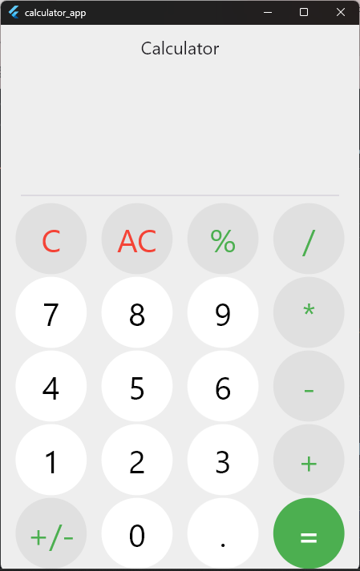

🧮 Calculator App

A responsive calculator application built with Flutter and Dart, featuring a simple and user-friendly interface for performing mathematical calculations.

✨ Features

- Perform mathematical calculations.
- Responsive UI for different screen sizes.
- Clean and user-friendly design.
- Evaluate mathematical expressions using the "math_expressions" package.

🛠️ Technologies Used

- Flutter — For building the application UI.
- Dart — The programming language used.
- math_expressions — For parsing and evaluating mathematical expressions.
- MediaQuery — For adapting the UI to different screen dimensions.

📸 Screenshots

🚀 Getting Started

1. Clone this repository:

   git clone YOUR_REPOSITORY_URL

2. Navigate to the project directory:

   cd YOUR_PROJECT_NAME

3. Install the dependencies:

   flutter pub get

4. Run the application:

   flutter run

🎯 Purpose

This project was developed to practice Flutter UI development, responsive design, and mathematical expression evaluation.

